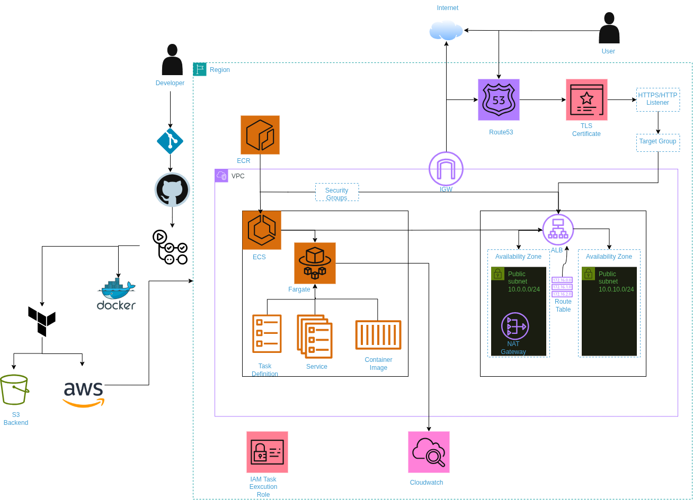

# Production-grade 2048 deployment on AWS ECS

A fully containerised 2048 game deployed on AWS ECS using Terraform for modular infrastructure provisioning, GitHub Actions for automated CI/CD, and CloudWatch for monitoring.

The infrastructure is deployed across two Availability Zones, with public and private subnets, an Application Load Balancer, NAT Gateway, Route 53 DNS and an ACM-managed TLS certificate.
## Tech stack

- **Infrastructure:** AWS, Terraform (modular architecture)
- **Terraform state management:** S3 remote state backend with bucket versioning, server-side encryption, public access blocking and native state locking.
- **Networking:** VPC, two Availability Zones, public/private subnets, NAT Gateway, security group restrictions.
- **Compute:** Amazon ECS with Fargate tasks running in private subnets, multi-AZ task distribution, availability zone rebalancing, health checks and deployment circuit breaker.
- **Load balancing:** Application Load Balancer deployed in public subnets, with target group health checks and deletion protection.
- **DNS & TLS:** Route 53, AWS Certificate Manager (ACM).
- **Containerisation:** Docker, unprivileged NGINX base image, Amazon ECR.
- **CI/CD:** GitHub Actions (separate infrastructure provisioning, application CI/CD and infrastructure destruction workflows).
- **Authentication:** GitHub Actions OIDC federation, AWS IAM.
- **IAM:** Dedicated OIDC deployment role and ECS task execution role.
- **Security scanning:** Anchore container image scanning, Checkov Terraform security scanning.
- **Observability:** Amazon CloudWatch (monitoring, centralised logging and alarms).

## Architecture



## How to reproduce

### 1. Prerequisites

- AWS account
- GitHub repository
- Terraform
- AWS CLI
- Docker (for local container builds)

### 2. Bootstrap

Before running the GitHub Actions workflows, bootstrap the foundational AWS resources required for Terraform remote state management and GitHub Actions authentication.

1. Navigate to the bootstrap directory:

   ```bash
   cd aws-infra/terraform/bootstrap
2. Create a .tfvars file containing the required configuration values.
3. Initialise Terraform:
   ```bash
   terraform init

4. Review and apply the bootstrap configuration:
   ```bash
   terraform plan -var-file="<file name>.tfvars"
   terraform apply -var-file="<file name>.tfvars"

5. Retrieve the IAM OIDC deployment role ARN.
6. Add the following GitHub repository variables:

    OIDC_ROLE_ARN - ARN of the GitHub Actions OIDC deployment role.

    AWS_REGION    - AWS deployment region.

   The bootstrap configuration provisions:

    An S3 bucket for Terraform remote state, with versioning, encryption and public access blocking
    A GitHub Actions OIDC identity provider.
    An IAM deployment role that allows GitHub Actions to authenticate to AWS using OIDC.

### 3. Provision infrastructure

Trigger the infrastructure provisioning workflow in GitHub Actions.

Terraform provisions the AWS infrastructure using reusable modules, including:

- VPC and networking resources
- Security Groups
- Public and private subnets across two Availability Zones
- NAT Gateway and routing
- Application Load Balancer
- Route 53 DNS records
- ACM TLS certificate
- ECS cluster, service and task definition
- ECR repository
- IAM roles and policies
- CloudWatch monitoring, log groups and alarms

Checkov is used to scan Terraform configurations for security and compliance issues.

### 4. Build and deploy application

Push changes to the configured deployment branch to trigger the CI/CD workflow.

The pipeline:

1. Authenticates to AWS using OIDC.
2. Builds the Docker image.
3. Uses GitHub Actions cache to optimise subsequent image builds.
4. Builds the application using an unprivileged NGINX base image, running the web server as a non-root user.
5. Scans the container image using Anchore.
6. Pushes the image to Amazon ECR.
7. Updates the ECS task definition.
8. Deploys the updated application to ECS.

### 5. Destroy infrastructure

A separate GitHub Actions workflow handles infrastructure destruction using Terraform.

This allows infrastructure teardown to be managed independently from application deployment and infrastructure provisioning.

## Decisions and trade-offs

- **Why ECS over EKS** — Simplifies container orchestration while avoiding the operational overhead of managing Kubernetes.
- **Why private subnets for ECS** — Keeps application tasks isolated from direct public internet access.
- **Why two Availability Zones** — Improves availability and provides fault tolerance across Availability Zones.
- **Why one NAT Gateway** — Reduces infrastructure costs, trading off some availability and potentially introducing cross-AZ networking costs.
- **Why ALB** — Provides application traffic distribution and health-based routing.
- **Why Route 53 and ACM** — Provides managed DNS and TLS certificate management.
 **Why ECS deployment circuit breaker** — Automatically rolls back unsuccessful deployments to maintain application availability.
- **Why rolling deployment percentages** — Maintains healthy application capacity while allowing ECS to launch replacement tasks before terminating existing ones.
- **Why graceful shutdown** — Allows NGINX to finish processing existing requests before container termination.
- **Why Terraform modules** — Promotes reusable, maintainable and consistent infrastructure definitions.
- **Why S3 remote state** — Centralises Terraform state for collaborative infrastructure management.
- **Why GitHub Actions OIDC** — Eliminates the need for long-lived AWS credentials in GitHub repository secrets.
- **Why separate workflows** — Separates infrastructure provisioning, application delivery and infrastructure destruction.
- **Why Anchore and Checkov** — Adds container image vulnerability scanning and Terraform infrastructure security scanning.
- **Why CloudWatch** — Centralises application logs, infrastructure monitoring and alarm management.


## Future improvements

- Introduce dedicated IAM roles for each GitHub Actions workflow (infrastructure provisioning, application deployment and infrastructure destruction), with stricter resource-level permissions to enforce separation of duties to improve least privilege.
- Deploy a dedicated NAT Gateway in each Availability Zone to eliminate the single point of failure and improve outbound network availability.
- Extend CloudWatch alarms to cover ECS memory utilisation and ALB HTTP 5XX errors, complementing the existing CPU utilisation alarm.